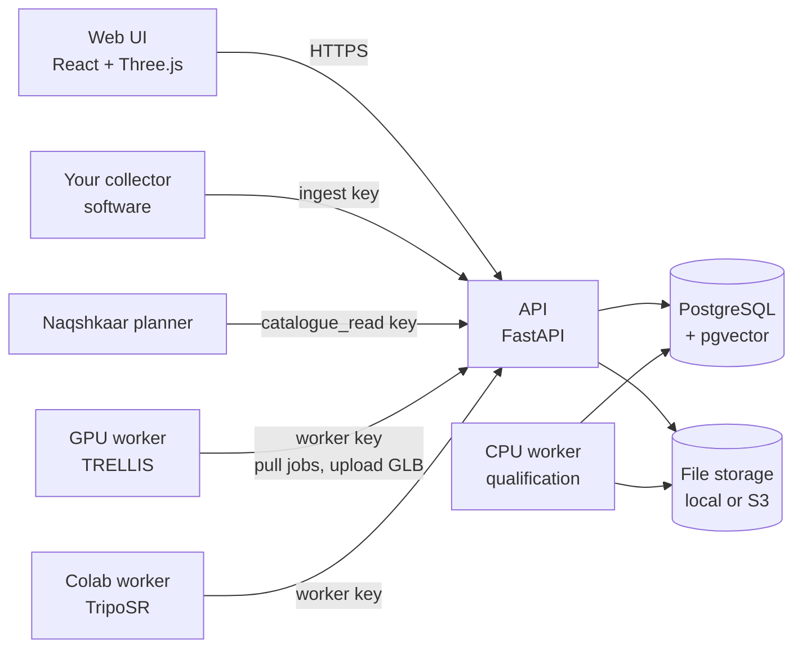

# Naqshkaar Catalogue Studio

The data-preparation application for **Naqshkaar** (CT-499, NED University). It builds the product catalogue
the planner depends on: buyable furniture, lighting, planters and decor from Pakistani retailers, each variant
with a dated PKR price, source-backed assembled dimensions, product images and a **metric 3D model** made with
open-source image-to-3D engines and checked by a person.

Setup, credentials and database connection: **[SETUP.md](SETUP.md)**.

## What it does

1. **Collect.** Enter a listing by hand or push it from your collector software through the ingest API.
   Upload one or many PNG/JPEG/WebP/SVG images per variant.
2. **Generate.** Pick one or more engines (TRELLIS, TRELLIS.2, TripoSR, Hunyuan3D-2 / 2mv / 2.1,
   Stable Fast 3D, InstantMesh, any CLI model, or the paid Meshy API). Each makes its own version so you can compare.
3. **Qualify.** The CPU worker stands each mesh upright on the floor, scales it to the recorded W × D × H
   and checks every axis is within max(5 mm, 1 %), that the GLB is self-contained and passes the Khronos validator.
4. **Review.** Preview in 3D against the recorded-dimension box, tick the six-point visual checklist, fix
   orientation or upload a Blender-corrected GLB.
5. **Publish.** "Approve and add to catalogue" admits the variant once every admission condition passes.
   The planner reads eligible, asset-ready variants from `/api/catalogue/variants`.

## SRS rules built in

| Rule | Where |
|---|---|
| A retailer **variant** is the unit of identity; price, dimensions, images and link refer to one variant (FR-CAT-001) | `product_variant` table |
| Prices are **dated observations**; a failed refresh never advances the last good check (FR-CAT-011, BR-COST-05) | `price_observation`, `v_latest_price` |
| Missing price is never zero; packaging sizes and category estimates never qualify (FR-CAT-003/004, DEC-CAT-02) | `domain/admission_rules.py` |
| Nothing becomes selectable without a human admission review (FR-CAT-009, DEC-CAT-01) | `services/catalogue.py` |
| Changing a value of an eligible variant withholds it for reassessment (FR-CAT-013) | `mark_reassessing()` |
| Assets are qualified against one **dimension revision**; new dimensions make old assets stale (FR-3D-005) | `asset_3d.dimension_id` |
| Extents within max(0.005 m, 0.01·d) on every axis (NFR-ACC-002) | `services/asset_pipeline.py` |
| Scale and visual fidelity are separate checks; a person approves the look (§6.2, FR-3D-003) | `asset_check`, `asset_review` |
| Eligibility and asset readiness are separate flags for the planner (FR-3D-006) | `v_catalogue_variant` |

## Architecture



## Repository layout

```
naqshkaar-catalogue-studio/
├── SETUP.md                      full setup guide (credentials, database, workers)
├── docker-compose.yml            db, api, worker, web (+ mock / GPU / MinIO profiles)
├── .env.example                  every credential you need to set
├── backend/                      FastAPI API and CPU worker
│   ├── sql/                      the schema (source of truth) and seed data
│   ├── migrations/               Alembic revisions that apply the SQL files
│   ├── app/
│   │   ├── domain/               pure rules: units, admission conditions, mesh maths, GLB parsing
│   │   ├── services/             catalogue lifecycle, images, ingest, jobs, asset pipeline, review
│   │   ├── routers/              HTTP endpoints
│   │   ├── models.py             ORM mapping of the SQL schema
│   │   ├── worker.py             qualification worker
│   │   └── cli.py                create users and API keys, seed, health check
│   ├── tools/validate.mjs        Khronos glTF-Validator wrapper
│   └── tests/
├── generator/                    3D generation worker (runs on GPU machines or Colab)
│   ├── naqshkaar_generator/engines/   one adapter per engine
│   ├── envs/                     per-engine install scripts
│   ├── colab/                    Colab notebook
│   └── docker/                   GPU worker image (TripoSR)
├── frontend/                     React + Vite + Three.js UI
├── scripts/                      ingest examples: JSON and CSV import
└── docs/                         database, API, engines, workflow
```

## Documentation

- [docs/database.md](docs/database.md): tables, constraints and the ER diagram
- [docs/api.md](docs/api.md): endpoints, ingest payload, worker protocol, catalogue API
- [docs/engines.md](docs/engines.md): engine comparison, parameters, adding a new engine
- [docs/workflow.md](docs/workflow.md): states of variants, jobs and assets
- [generator/README.md](generator/README.md): running workers
