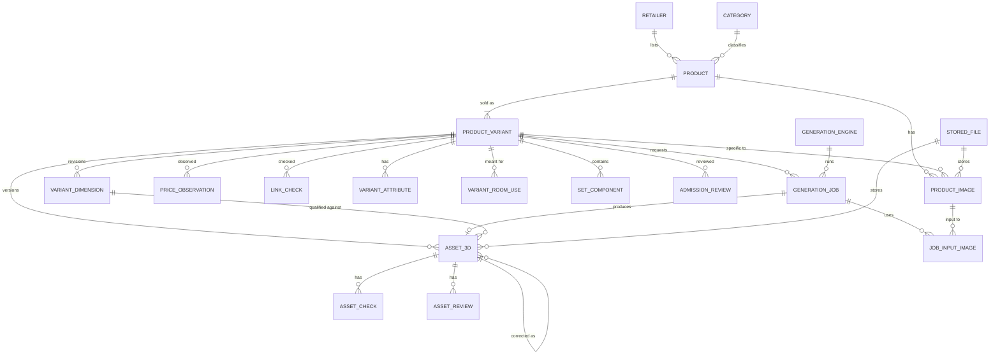

# Database

PostgreSQL 16 (14+ works). The schema lives in `backend/sql/` and is the source of truth; `backend/app/models.py`
only maps it. Change the SQL first, add an Alembic revision that runs it, then mirror the change in the ORM.

| File | Contents |
|---|---|
| `0001_initial_schema.sql` | enums, tables, constraints, triggers, views |
| `0002_optional_pgvector.sql` | `variant_embedding` table, only if the `vector` extension is available |
| `0003_seed_reference.sql` | 39 categories and the 11-engine registry (idempotent) |

## Design rules

- **Unknown is NULL.** No price, dimension or attribute ever defaults to zero or a category size. A failed price
  check is stored as its own row with `outcome = 'failed'` and a reason, and carries no price.
- **History is kept.** Prices are observations; dimensions are revisions; 3D assets are versions; reviews are rows.
  Nothing is overwritten in place, so you can always say what was known when.
- **The database enforces what it can.** Positive dimensions, non-negative prices, one current dimension revision
  per variant, one served asset per variant, a qualified asset must have a GLB and a dimension revision, an eligible
  variant must have `eligible_since`, API key scopes are a fixed set.

## Tables

| Group | Table | Purpose |
|---|---|---|
| People | `app_user` | studio accounts and roles |
| | `api_key` | hashed keys with scopes `ingest`, `worker`, `catalogue_read` |
| Files | `stored_file` | every stored blob (images, GLBs, previews) with SHA-256 |
| Reference | `retailer` | Pakistani retailers, with usage-terms notes |
| | `category` | furniture / lighting / planter / decor tree, default placement, planar flag (rugs) |
| Catalogue | `product` | a retailer listing; `(retailer_id, external_ref)` makes ingest idempotent |
| | `product_variant` | the purchasable unit: sale unit, configuration, status |
| | `variant_room_use` | intended room types (FR-RET-003) |
| | `variant_attribute` | style / colour / material / finish with source and verified flag |
| | `variant_dimension` | revisioned W × D × H in metres, entered values and unit, source text and reference |
| | `price_observation` | dated PKR price, sale unit, availability, source, success or failure |
| | `link_check` | purchase-link checks (ok / mismatch / unreachable) |
| | `set_component` | contents of a set sale unit, each with quantity and dimensions |
| | `product_image` | originals plus normalised PNG and thumbnail; view angle, role, reviewed |
| | `admission_review` | each human decision with a snapshot of every admission condition |
| 3D | `generation_engine` | engine registry: licence, VRAM, multi-image support, default params |
| | `generation_worker` | worker heartbeats and capabilities |
| | `generation_job` | queue entries with status, attempts, progress, logs, runtime metadata |
| | `job_input_image` | which images a job used, in order |
| | `asset_3d` | mesh versions: source and processed GLB, dimension revision, orientation, extents, status |
| | `asset_check` | one row per automated or human check |
| | `asset_review` | reviewer decisions with the visual checklist |
| Audit | `audit_log` | who did what, by user or API key |

Views: `v_latest_price` (latest *successful* observation), `v_latest_link_check`, and `v_catalogue_variant`
(what the planner reads; `eligible` and `asset_ready` are separate columns).

## Entity relationships

## Field reference: the product a planner sees

| What you asked to store | Column(s) | Null allowed |
|---|---|---|
| Product name | `product.name` | no |
| Type / category | `product.category_id` → `category.code`, `product_group`, `default_placement` | yes (draft) |
| Variant / colour option | `product_variant.variant_label`, `variant_key`, `configuration` | label yes |
| Colour | `variant_attribute(key='colour', value, colour_hex)` | yes (unknown) |
| Material, style, finish | `variant_attribute` | yes |
| Price | `price_observation.price_pkr` + `checked_at` + `source_url` | yes; never 0 for unknown |
| Availability | `price_observation.availability` | `unknown` |
| Dimensions | `variant_dimension.width_m / depth_m / height_m` (+ `entered_values`, `source_text`) | yes per axis |
| 2D images | `product_image` → `stored_file` (original, processed PNG, thumbnail) | — |
| 3D model | `asset_3d.glb_file_id` (metric GLB) and `source_file_id` (raw engine output) | until generated |
| Purchase link | `product_variant.listing_url` or `product.listing_url`, checked in `link_check` | yes |
| Retailer | `product.retailer_id` | no |
