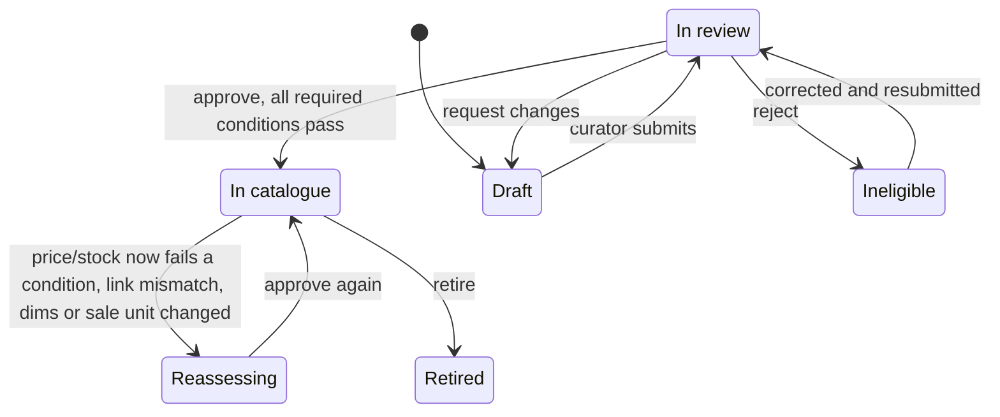
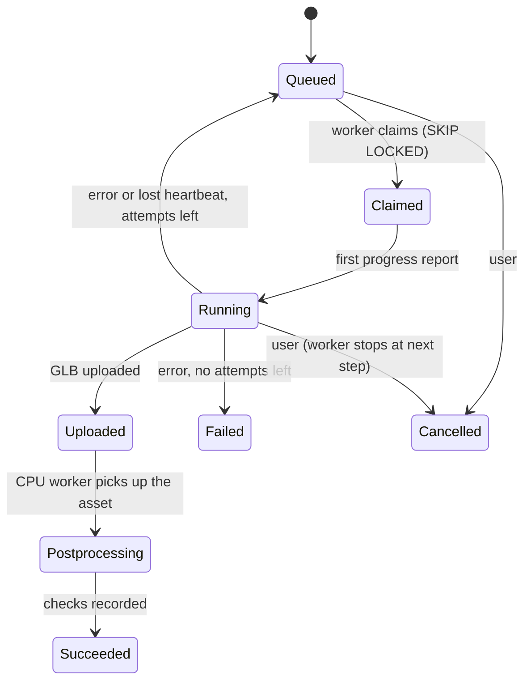
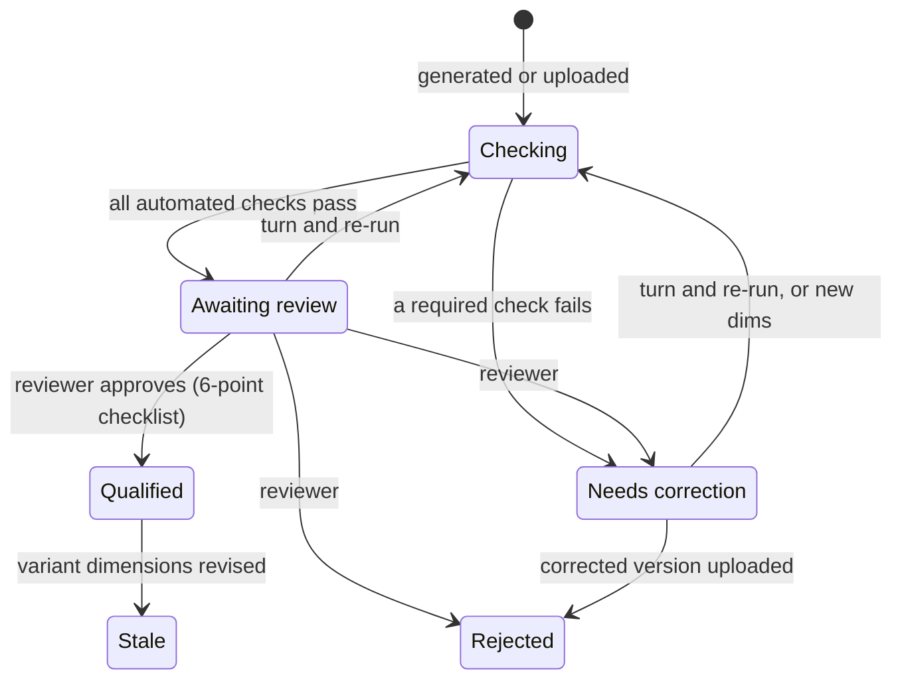

# Workflow and states

Three readiness concepts stay separate (SRS §3): a variant can be **eligible** (catalogue admission), its 3D asset
can be **qualified** (scale and look checked), and only the planner decides whether a layout is **verified**.
None implies another.

## Variant (catalogue admission)

Admission conditions (all required unless marked advisory): identifiable variant · supported category ·
intended room use · PKR price recorded · unambiguous sale unit · assembled source-backed W × D × H ·
reviewed image of this variant · purchase link checked and matching · dated source evidence · not known
to be unorderable · set contents for sets · *(advisory)* set component dimensions · *(advisory)* recent price.

## Generation job

## 3D asset

Automated checks: file opens · finite coordinates · non-degenerate extents · recorded W × D × H available ·
width / depth / height within max(5 mm, 1 %) · proportions (warn above ×1.15, fail above ×1.5) · exported GLB
re-opens · textures embedded · Khronos glTF validator · triangle budget (warning). Then the person-only
**visual review**.

Only one qualified asset per variant is *selected* (served to the planner). The planner gets `asset_ready = true`
only when that asset was qualified against the variant's **current** dimension revision.
